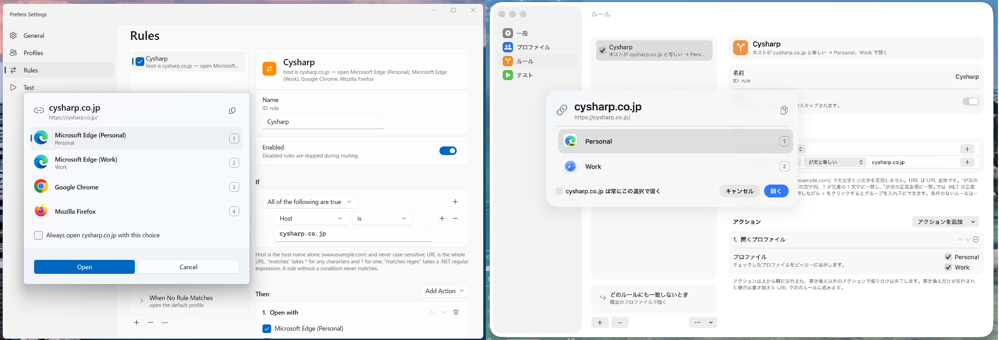
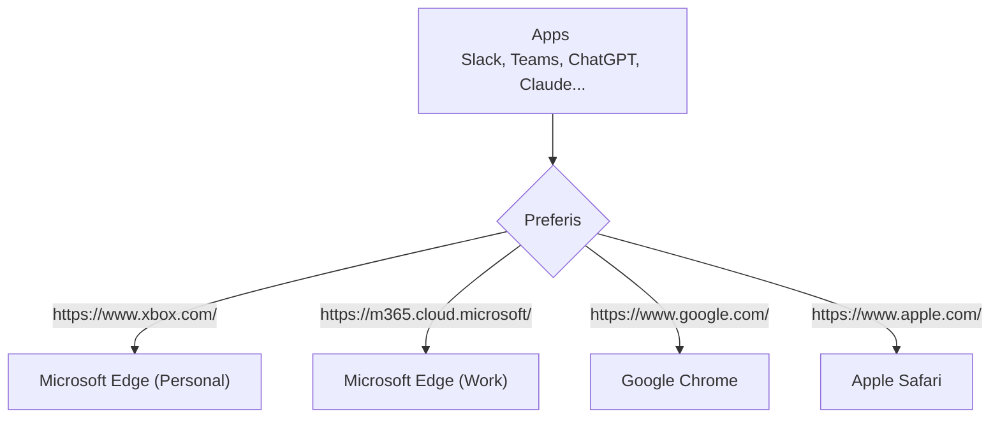

# Preferis

📖 ドキュメントサイト: [English](https://cysharp.github.io/Preferis/) | [日本語](https://cysharp.github.io/Preferis/ja/)

Preferis はルールに従ってリンクをブラウザーやブラウザープロファイルに振り分けるクロスプラットフォームなアプリケーションです。OS の既定のブラウザーとして登録しておくことで URL を開くブラウザーを柔軟にコントロールできます。






## 特徴
Preferis は以下の特徴を持っています。

- Windows と macOS のクロスプラットフォームの対応
- OS ネイティブな設定とブラウザー選択 UI
- OneDrive、iCloud 等のクラウドストレージによるデバイス間の設定同期のサポート
- ブラウザーとプロファイルの自動検出
- 正規表現などを用いた柔軟なルールの定義

「クラウドストレージによるデバイス間の設定同期のサポート」は複数のデバイスで同じルールを適用したい場合には役立つ機能です。例えばデスクトップの Windows とラップトップの macOS 上で設定を共有し、ルールは共通に扱うユースケースを前提として設計されています。

## インストールと利用方法

[インストールについてのドキュメント](https://cysharp.github.io/Preferis/ja/installation)を参照してください。

インストール後、[利用を始めるにはクイックスタート](https://cysharp.github.io/Preferis/ja/quickstart)を参照してください。

## ビルドと開発

プロジェクトをビルドして実行するには以下のコマンドを使用します:

```bash
# on Windows
dotnet build .\build\Preferis.Build.proj
.\artifacts\win-x64\Preferis\Preferis.exe

# on macOS
dotnet build .\build\Preferis.Build.proj
./artifacts/osx-arm64/Preferis/Preferis.app/Contents/MacOS/Preferis
```

## ライセンス

```
MIT License

Copyright (c) 2026 Cysharp, Inc.

Permission is hereby granted, free of charge, to any person obtaining a copy
of this software and associated documentation files (the "Software"), to deal
in the Software without restriction, including without limitation the rights
to use, copy, modify, merge, publish, distribute, sublicense, and/or sell
copies of the Software, and to permit persons to whom the Software is
furnished to do so, subject to the following conditions:

The above copyright notice and this permission notice shall be included in all
copies or substantial portions of the Software.

THE SOFTWARE IS PROVIDED "AS IS", WITHOUT WARRANTY OF ANY KIND, EXPRESS OR
IMPLIED, INCLUDING BUT NOT LIMITED TO THE WARRANTIES OF MERCHANTABILITY,
FITNESS FOR A PARTICULAR PURPOSE AND NONINFRINGEMENT. IN NO EVENT SHALL THE
AUTHORS OR COPYRIGHT HOLDERS BE LIABLE FOR ANY CLAIM, DAMAGES OR OTHER
LIABILITY, WHETHER IN AN ACTION OF CONTRACT, TORT OR OTHERWISE, ARISING FROM,
OUT OF OR IN CONNECTION WITH THE SOFTWARE OR THE USE OR OTHER DEALINGS IN THE
SOFTWARE.
```
