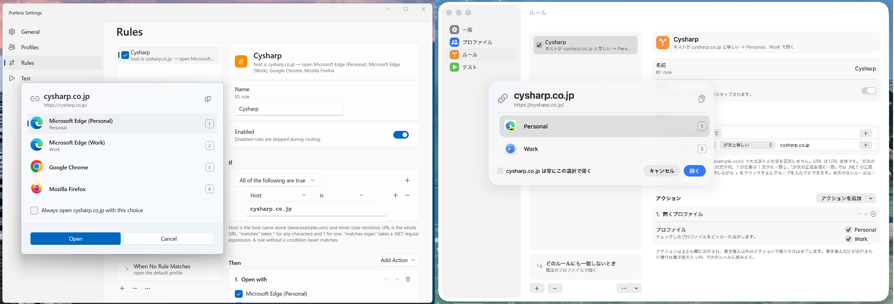
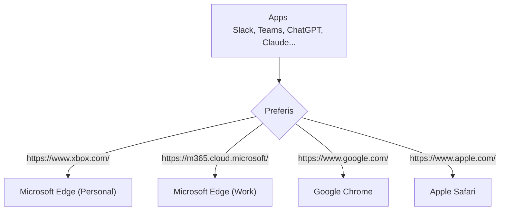

# Preferis

📖 Documentation: [English](https://cysharp.github.io/Preferis/) | [日本語](https://cysharp.github.io/Preferis/ja/)

Preferis is a cross-platform application that routes links to browsers and browser profiles based on rules. Set it as your OS's default browser to control which browser opens each URL.





## Features

Preferis provides the following features:

- Cross-platform support for Windows and macOS
- Native settings and browser picker interfaces
- Configuration syncing across devices through cloud storage such as OneDrive and iCloud
- Automatic browser and profile detection
- Flexible rules, including regular expressions

Configuration syncing is useful when you want to apply the same rules on multiple devices. It is designed for scenarios such as sharing settings between a Windows desktop and a macOS laptop while keeping the same rules on both.

## Installation and usage

See the [installation guide](https://cysharp.github.io/Preferis/installation) for installation instructions.

After installing Preferis, follow the [Quick Start](https://cysharp.github.io/Preferis/quickstart) to get started.

## Build & Development

To build the project, run the following command:

```bash
# on Windows
dotnet build .\build\Preferis.Build.proj
.\artifacts\win-x64\Preferis\Preferis.exe

# on macOS
dotnet build .\build\Preferis.Build.proj
./artifacts/osx-arm64/Preferis/Preferis.app/Contents/MacOS/Preferis
```

## License

```
MIT License

Copyright (c) 2026 Cysharp, Inc.

Permission is hereby granted, free of charge, to any person obtaining a copy
of this software and associated documentation files (the "Software"), to deal
in the Software without restriction, including without limitation the rights
to use, copy, modify, merge, publish, distribute, sublicense, and/or sell
copies of the Software, and to permit persons to whom the Software is
furnished to do so, subject to the following conditions:

The above copyright notice and this permission notice shall be included in all
copies or substantial portions of the Software.

THE SOFTWARE IS PROVIDED "AS IS", WITHOUT WARRANTY OF ANY KIND, EXPRESS OR
IMPLIED, INCLUDING BUT NOT LIMITED TO THE WARRANTIES OF MERCHANTABILITY,
FITNESS FOR A PARTICULAR PURPOSE AND NONINFRINGEMENT. IN NO EVENT SHALL THE
AUTHORS OR COPYRIGHT HOLDERS BE LIABLE FOR ANY CLAIM, DAMAGES OR OTHER
LIABILITY, WHETHER IN AN ACTION OF CONTRACT, TORT OR OTHERWISE, ARISING FROM,
OUT OF OR IN CONNECTION WITH THE SOFTWARE OR THE USE OR OTHER DEALINGS IN THE
SOFTWARE.
```
