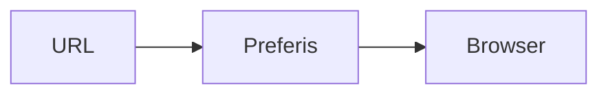

# Preferis documentation site

[Docusaurus](https://docusaurus.io/) を使用したドキュメントサイトです。
[MagicOnion の構成](https://github.com/Cysharp/MagicOnion/tree/main/docs)を参考に、TypeScript、pnpm、ドキュメント専用モードを使用しています。

## 必要な環境

- Node.js 24 (`.node-version` に記載)
- pnpm 11.25.0 (`package.json` の `packageManager` に記載)

## ローカル開発

リポジトリのルートから実行します。

```sh
cd site
pnpm install --frozen-lockfile
pnpm start
```

英語版は `http://localhost:3000/Preferis/` で確認できます。日本語版の開発サーバーは次のコマンドで起動します。

```sh
pnpm start:ja
```

日本語版は `http://localhost:3000/Preferis/ja/` です。開発サーバーは一度に一言語を表示します。

## ビルドと確認

```sh
pnpm typecheck
pnpm build
pnpm serve
```

`pnpm build` は英語・日本語の両方を `build/` に出力します。`pnpm serve` でビルド成果物を表示すると、言語切り替えも確認できます。リンク切れはビルドエラーになります。

## ドキュメントの追加と翻訳

- 英語 (既定言語): `docs/`
- 日本語: `i18n/ja/docusaurus-plugin-content-docs/current/`
- 日本語のナビゲーション: `i18n/ja/docusaurus-theme-classic/navbar.json`
- サイト共通設定: `docusaurus.config.ts`

英語版と日本語版では、同じ相対パス・ドキュメント ID・`slug` を使用してください。例えば `docs/usage.md` を追加したら、日本語版を `i18n/ja/docusaurus-plugin-content-docs/current/usage.md` に追加します。サイドバーはファイル構成から自動生成され、順序はページの front matter の `sidebar_position` とカテゴリーの `_category_.json` の `position` で指定します。番号のないページは番号のあるページの後ろにファイル名順で並ぶため、ページを追加するときは両言語の front matter に番号を付けてください。未翻訳のページは英語の内容にフォールバックするため、PR では両言語のファイルを確認してください。

標準テーマのボタンなどは Docusaurus の日本語訳を使用します。ナビゲーションなどの翻訳キーを追加・更新する場合は、次を実行して生成された JSON を編集します。

```sh
pnpm write-translations --locale ja
```

リポジトリ直下の `docs/` は既存の設計・仕様ドキュメントです。公開サイトのコンテンツは `site/docs/` 以下で管理します。

## Mermaid の図

Markdown に `mermaid` コードブロックを書くと、図として表示されます。

````md

````

`@docusaurus/theme-mermaid` を使用し、英語・日本語の両方で有効です。詳しい構文は [Docusaurus のドキュメント](https://docusaurus.io/docs/markdown-features/diagrams)を参照してください。

## GitHub Pages への公開

[ワークフロー](../.github/workflows/publish-docs.yml)が以下を実行します。

- `site/**` またはワークフローを変更した PR: 型チェックと両言語のビルド。
- 同じパスを変更した `main` への push: 検証後に GitHub Pages へ公開。
- Actions の **Publish documentation** → **Run workflow** (`main` を選択): 手動公開。

アプリのビルドとテストのワークフロー ([build-debug.yaml](../.github/workflows/build-debug.yaml)) は、変更が `site/**` とこのワークフローだけの push / PR では実行されません。

初回はリポジトリの **Settings → Pages → Build and deployment → Source** を **GitHub Actions** に設定してください。`github-pages` 環境に承認ルールがある場合は、そのルールに従います。公開には標準の `GITHUB_TOKEN` と OIDC を使用し、追加の PAT や `gh-pages` ブランチは不要です。PR と `main` 以外のブランチからは公開しません。

- 英語: `https://cysharp.github.io/Preferis/`
- 日本語: `https://cysharp.github.io/Preferis/ja/`

ホスト先を変える場合は `docusaurus.config.ts` の `url` と `baseUrl` を更新してください。
