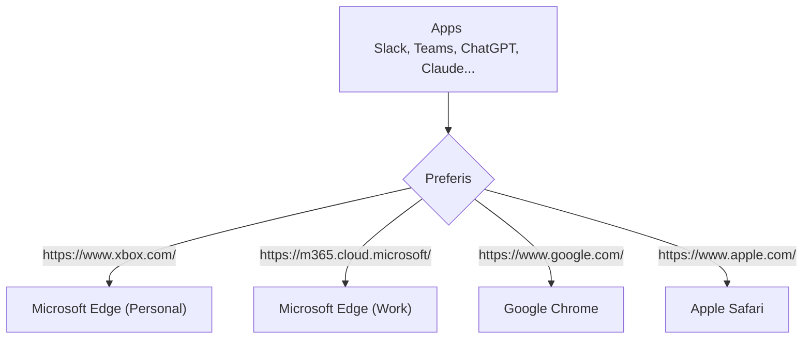

Preferis is a cross-platform application that routes links to browsers and browser profiles based on rules. Set it as your OS's default browser to control which browser opens each URL.

For example, when you click a link in Slack, Preferis can open https://work.example in your work profile and https://sns.example in your personal profile. It can also use a particular browser profile when you need to sign in to a specific SaaS application.

## Features

Preferis provides the following features:

- Cross-platform support for Windows and macOS
- Native settings and browser picker interfaces
- Configuration syncing across devices through cloud storage such as OneDrive and iCloud
- Automatic browser and profile detection
- Flexible rules, including regular expressions

Configuration syncing is useful when you want to apply the same rules on multiple devices. It is designed for scenarios such as sharing settings between a Windows desktop and a macOS laptop while keeping the same rules on both.

## Terminology and routing flow

1. Define **profiles** for the browsers, browser profiles, or commands you want to use.
2. Define **rules** that combine URL conditions with actions. Rules are evaluated from top to bottom, and the first matching rule is applied.
3. If the matching rule offers multiple profiles, use the **picker** to choose where to open the link.
4. URLs that do not match any rule open with the default profile.

## System requirements

Preferis has been tested on the following systems:

- Windows 11 or later
- macOS Tahoe 26 or later

## Source code

Preferis is available under the [MIT license](https://github.com/Cysharp/Preferis/blob/main/LICENSE). See the [GitHub repository](https://github.com/Cysharp/Preferis) for source code and development updates.
