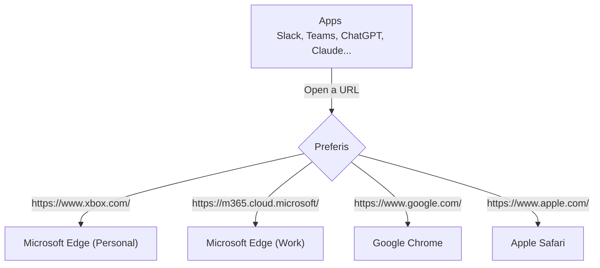

Preferis はルールに従ってリンクをブラウザーやブラウザープロファイルに振り分けるクロスプラットフォームなアプリケーションです。OS の既定のブラウザーとして登録しておくことで URL を開くブラウザーを柔軟にコントロールできます。

例えば Slack でリンクをクリックした際、https://work.example は仕事用のプロファイルで開き、https://sns.example は個人用のプロファイルで開く、他にも特定の SaaS にログインするにはこのブラウザープロファイルで開きたいといったユースケースを Preferis で解決できます。

## 特徴
Preferis は以下の特徴を持っています。

- Windows と macOS のクロスプラットフォームの対応
- OS ネイティブな設定とブラウザー選択 UI
- OneDrive、iCloud 等のクラウドストレージによるデバイス間の設定同期のサポート
- ブラウザーとプロファイルの自動検出
- 正規表現などを用いた柔軟なルールの定義

「クラウドストレージによるデバイス間の設定同期のサポート」は複数のデバイスで同じルールを適用したい場合には役立つ機能です。例えばデスクトップの Windows とラップトップの macOS 上で設定を共有し、ルールは共通に扱うユースケースを前提として設計されています。

## 用語と動作の流れ

1. 利用するブラウザーやブラウザープロファイル、コマンドを **プロファイル** として定義します
2. URL の条件とアクションを組み合わせた **ルール** を定義します。ルールは上から順に評価され、最初に一致したルールが適用されます
3. 一致したルールでプロファイル候補が複数ある場合は **ピッカー** で開く先を選択します
4. どのルールにも一致しない URL は既定のプロファイルで処理します

## 動作環境

Preferis は以下の環境で動作確認を行っています:

- Windows 11 以降
- macOS Tahoe 26 以降

## ソースコード

Preferis は [MIT ライセンス](https://github.com/Cysharp/Preferis/blob/main/LICENSE)で公開されています。ソースコードと開発状況は [GitHub リポジトリ](https://github.com/Cysharp/Preferis)で確認できます。
